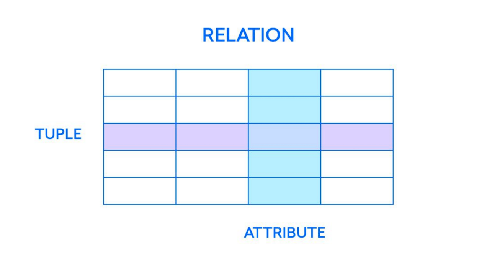
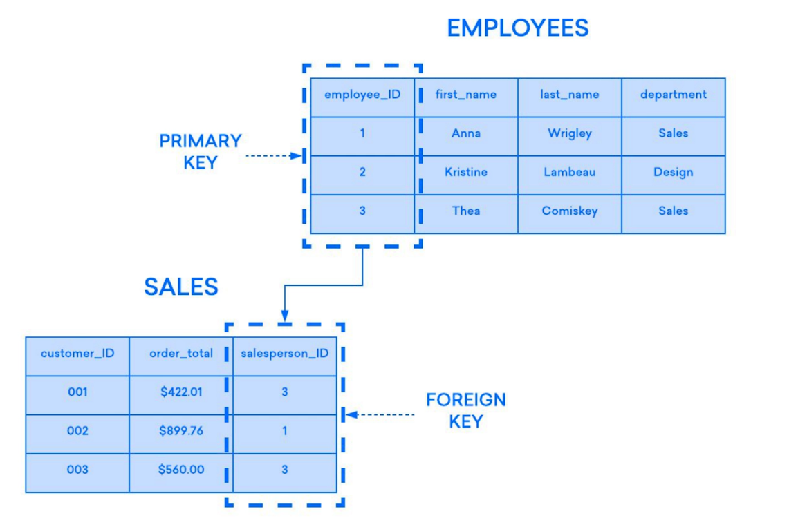
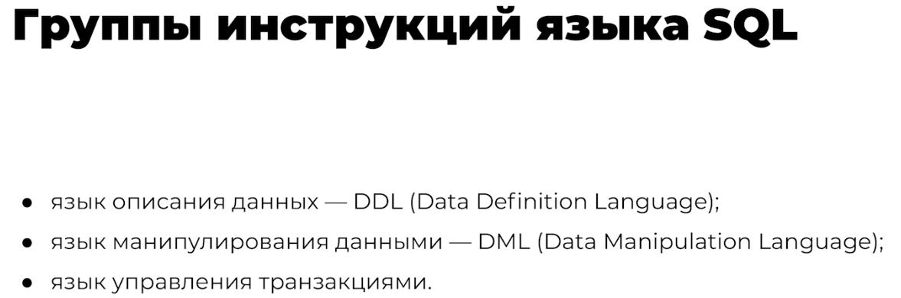
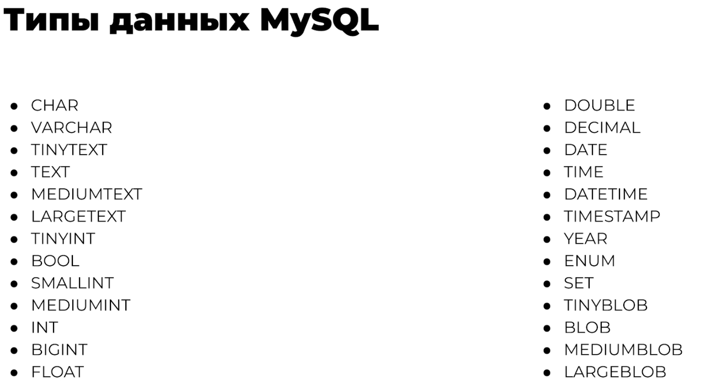
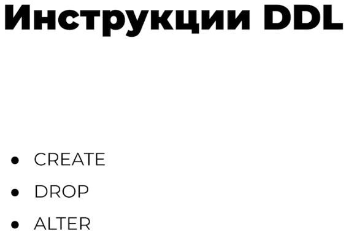

# Реляционные базы данных

## Типы данных MySQL

## DML, DDL, Transaction

## Транзакции

### ACID

[ACID. Что под капотом у транзакции](https://habr.com/ru/companies/simbirsoft/articles/572540/) (Хабр)

| Свойство | Что гарантирует |
|---|---|
| **Атомарность** (Atomicity) | транзакция не может выполниться частично |
| **Согласованность** (Consistency) | после завершения транзакции данные остаются консистентными и валидными |
| **Изолированность** (Isolation) | параллельно выполняемые транзакции не влияют друг на друга |
| **Прочность** (Durability) | если пользователь получил подтверждение, изменения не будут отменены из-за сбоя |

### BASE

- Базовая доступность (Basically available)
- Мягкое состояние (Soft state)
- Согласованность в конечном счёте (Eventual consistency)
