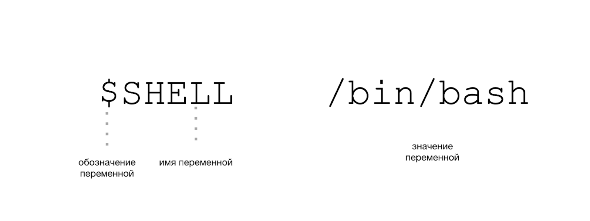
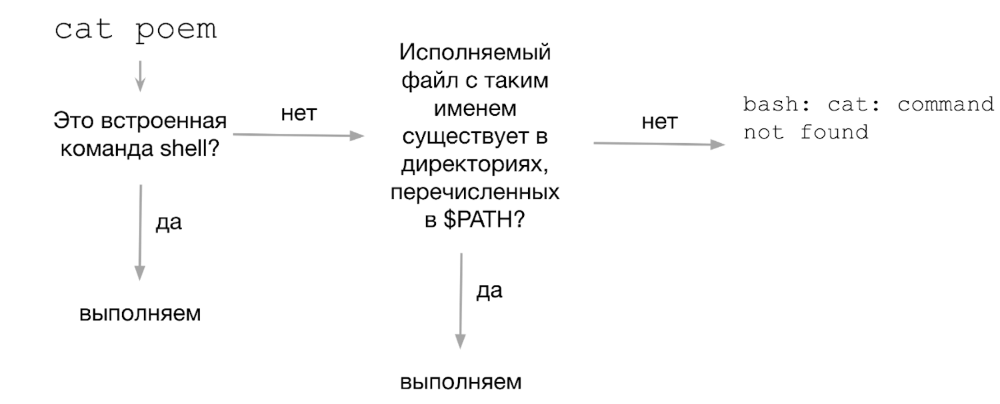
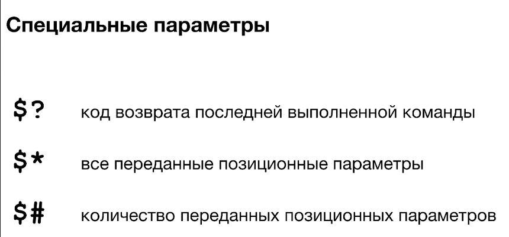
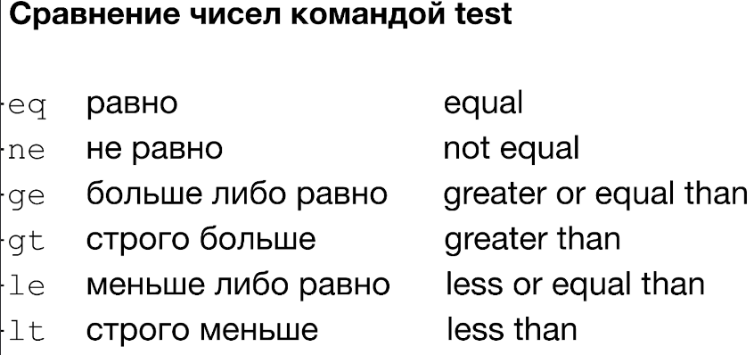
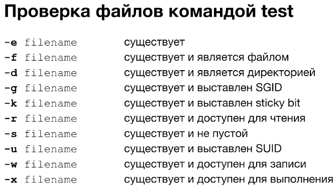
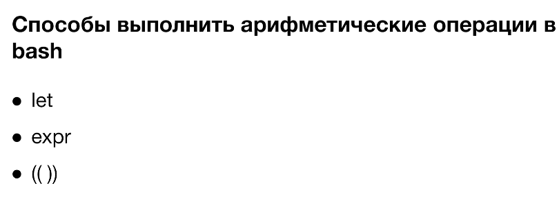
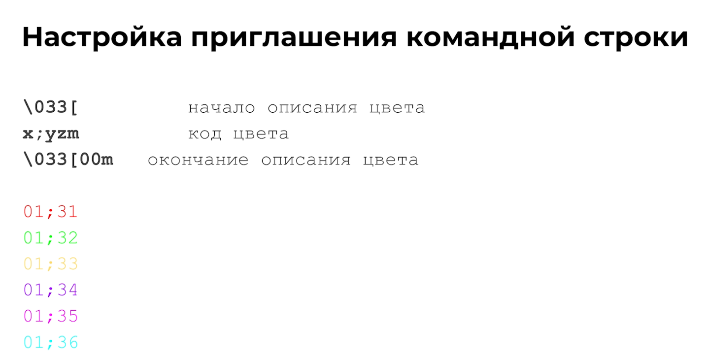
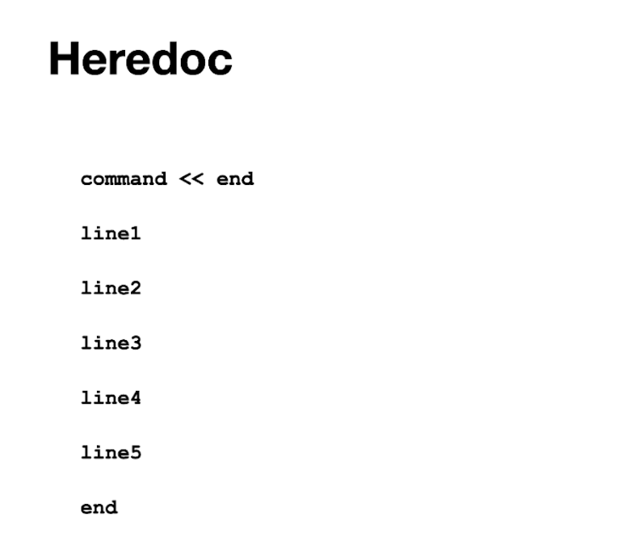

# Скрипты Bash

Скрипт начинается со строки, которая указывает интерпретатор (шебанг):

```bash
#!/bin/bash
```

[Написание скриптов на Bash](https://losst.pro/napisanie-skriptov-na-bash) (Losst)

## Переменные и параметры

Обозначение переменной в Bash:



Принцип определения исполняемого файла:



Специальные параметры:


Код возврата последней команды (`$?`) описан на странице [Процессы и потоки вывода](processes.md#коды-возврата).

## Запуск скрипта без `./`

Чтобы скрипт запускался по имени, добавьте его каталог в `$PATH`.

1. Убедитесь, что у скрипта есть право на исполнение:

    ```bash
    chmod +x my_script.sh
    ```

2. Добавьте каталог в `PATH`. Для этого в конец файла настроек шелла (обычно `~/.bashrc` или `~/.bash_profile`) допишите строку:

    ```bash
    export PATH=$PATH:"/home/<user>/scripts"
    ```

3. Примените изменения:

    ```bash
    source ~/.bashrc
    ```

Теперь скрипты из этого каталога запускаются без `./`.







!!! warning "Пробелы в путях"
    Если скрипт работает с каталогом, в имени которого есть пробелы, переменную с путём нужно заключать в двойные кавычки: `"$dir"`.

## Условный оператор if

```bash
a=5
b=5

if [ "$a" = "$b" ]; then
    echo "A = B"
else
    echo "A не равно B"
fi
```

!!! tip "Пробелы в скобках"
    Вокруг `[` и `]` пробелы обязательны: `[ "$a" = "$b" ]` работает, `["$a"="$b"]` нет.

## Оператор выбора case

`case` сопоставляет выражение (например, переменную) с набором значений и выполняет команды первого совпавшего варианта.

```bash
case "$variable" in
    "option1") command ;;
    "option2") command ;;
    *) command ;;
esac
```

[Конструкция case](https://metanit.com/os/linux/12.9.php) (metanit.com)

## Арифметические операции

[Арифметические операции в Bash-скрипте](https://devhops.ru/linux/bash/arithmetics.php)



`let` — встроенная команда bash для базовой арифметики. Результат на стандартный вывод она не печатает:

```bash
let <арифметическая операция>
```

`expr` похож на `let`, но по умолчанию печатает ответ. Результат можно сохранить в переменную через подстановку команды. Вокруг операторов нужны пробелы, а выражения с пробелами не нужно заключать в кавычки:

```bash
x=$(expr 2 + 2)
```

## Циклы

=== "while"

    Выполняет команды, пока условие истинно.

    ```bash
    while [CONDITION]
    do
      [COMMANDS]
    done
    ```

    [Цикл while в Bash](https://routerus.com/bash-while-loop/)

=== "until"

    Выполняет команды, пока условие ложно.

    ```bash
    until [CONDITION]
    do
      [COMMANDS]
    done
    ```

## Функции

```bash
my_function() {
    команда1
    команда2
}
```

Имя функции не должно совпадать с именем существующей команды или функции. Команды в теле функции пишутся с новой строки.

[Функции bash в скриптах](https://losst.pro/funktsii-bash-v-skriptah) (Losst)

## Приглашение командной строки

[Настройка строки приглашения Bash](https://zencod.ru/articles/prompt-string-bash/) (ZENCOD)



!!! tip "Поиск по истории"
    ++ctrl+r++ ищет по истории введённых команд в шелле.

## Многострочный текст в команде (heredoc)

[Bash Heredoc](https://linuxize.com/post/bash-heredoc/)


