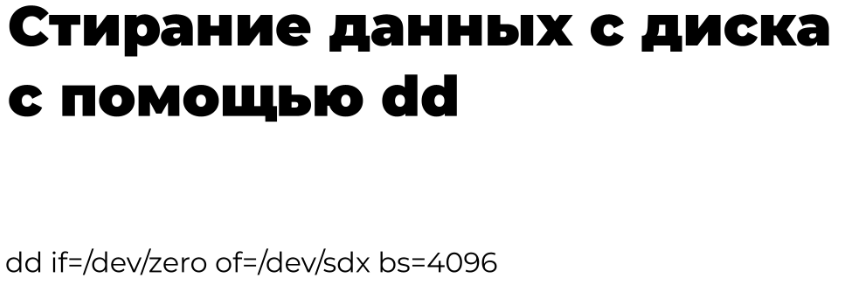
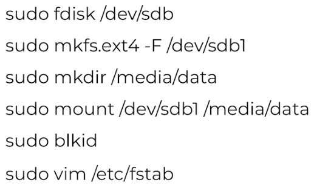

# Файловая система и диски

## Символические и жёсткие ссылки

[Символические и жёсткие ссылки Linux](https://losst.pro/simvolicheskie-i-zhestkie-ssylki-linux) (Losst)

## Каталог /dev

- [Команда mknod](https://linux-faq.ru/page/komanda-mknod)
- [Подключённые устройства Linux](https://losst.pro/podklyuchennye-ustrojstva-linux) (Losst)
- [How to Create Block Device Files Using mknod Command](https://www.tecmint.com/mknod-command/) (Tecmint)

## Монтирование файловой системы

[Монтирование диска в Linux](https://losst.pro/montirovanie-diska-v-linux) (Losst)

## Разметка диска

- [Команда fdisk в Linux](https://losst.pro/komanda-fdisk-v-linux) (Losst)
- [Автоматическое монтирование: fstab и systemd](https://losst.pro/avtomaticheskoe-montirovanie-fstab-i-systemd) (Losst)

Так выглядит монтирование добавленного диска:

