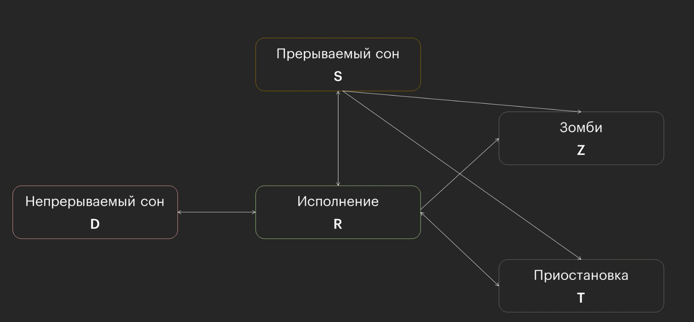

# Межпроцессное взаимодействие

## 5 состояний процесса



## IPC

Способы обмена данными между процессами:

- пайпы (конвейер)
- сигналы
- сокеты
- очереди сообщений
- семафоры
- совместно используемая память

### Виды IPC

- локальные
- удалённые
- высокоуровневые

## Полезные команды

Узнать родительский процесс:

```bash
ps -o ppid= -p <PID>
```
