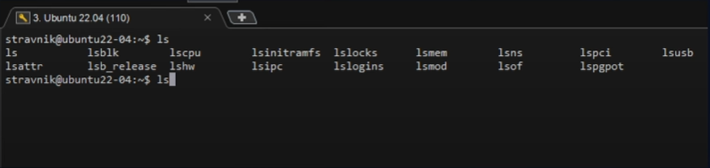
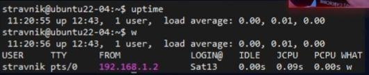
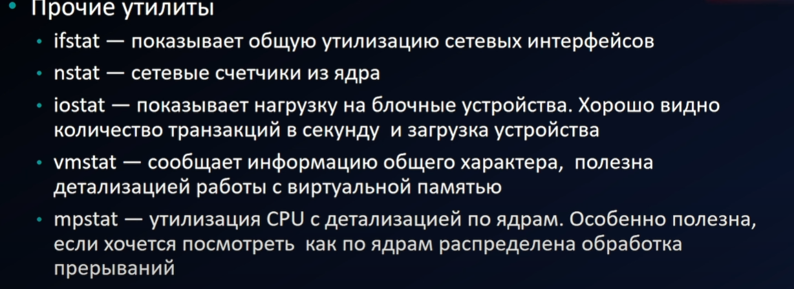
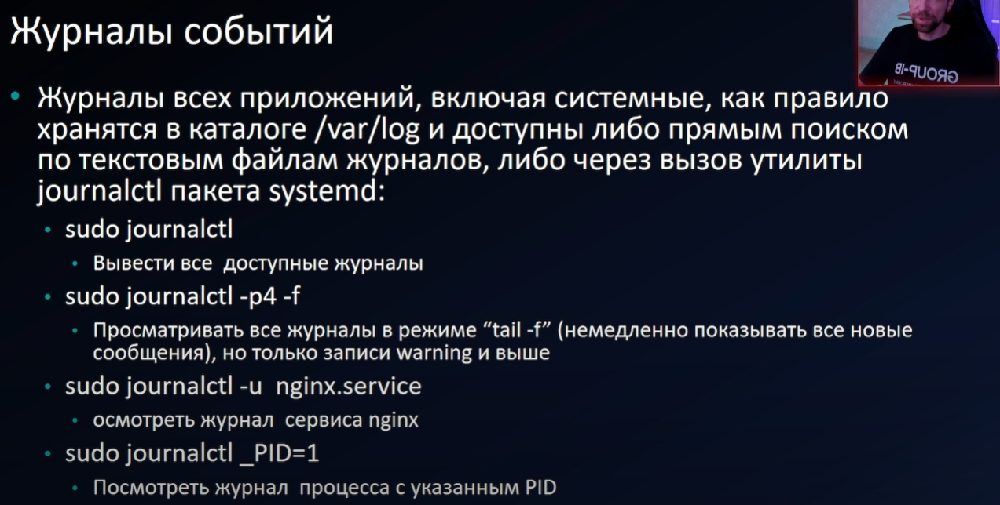

# Мониторинг системы

Команды для быстрого осмотра сервера: что за система, какие диски и сети, насколько она загружена.

## Информация о системе

| Что узнать | Команда |
|---|---|
| Краткое имя сервера | `hostname` |
| Полное имя | `hostname -f` |
| Версия ОС | `cat /etc/os-release` |
| Версия ядра | `uname -r` |
| Модель процессора | `cat /proc/cpuinfo \| less` |
| Объём памяти | `free -h` (старый способ: `sudo dmesg \| grep Memory`) |

## Диски

| Что узнать | Команда |
|---|---|
| Дисковые устройства | `lsblk --fs` |
| То же с выбором колонок | `lsblk -o NAME,SIZE,FSTYPE,FSSIZE,FSUSED,MOUNTPOINT,PARTTYPENAME` |
| Точки монтирования | `cat /etc/fstab` |
| Свободное место | `df -h` |

## Сеть

```bash
ip link show                     # интерфейсы
ip -br address show              # адреса кратко
ip route show                    # маршруты
netstat -rn                      # таблица маршрутизации (старый способ)
ifconfig                         # интерфейсы (старый способ)
sudo lshw -class network -short  # сетевое оборудование
cat /etc/resolv.conf             # DNS-серверы
```

## Время

```bash
date
ls -l /etc/localtime
timedatectl
```

## Линейка утилит ls*



## Производительность

### Процессор и память

```bash
openssl speed -evp md5 -multi N
sysbench cpu run --threads=N --time=60
sysbench memory run --threads=N --time=60
```

`N` — число потоков, обычно по числу ядер.

### Диски

Скорость записи:

```bash
dd if=/dev/zero of=/tmp/test1.img bs=256M count=20 oflag=dsync
```

Скорость чтения:

```bash
time dd if=/path/to/file of=/dev/null bs=8k
```

!!! tip "Уберите за собой"
    Тестовый файл `/tmp/test1.img` занимает 5 ГБ. Удалите его после замера.

## Нагрузка и процессы

Время работы и средняя нагрузка: `uptime` или `w`.



Список процессов: `ps -ef`. Дочерние процессы: `pstree -p <PID>`, где `PID` — идентификатор процесса.




