# Системы инициализации и systemd

## Системы инициализации

- [Системы инициализации Linux](https://losst.pro/sistemy-initsializatsii-linux) (Losst)
- [Глава 9. Сервисы Unix](https://debian-handbook.info/browse/ru-RU/stable/unix-services.html) (Руководство администратора Debian)

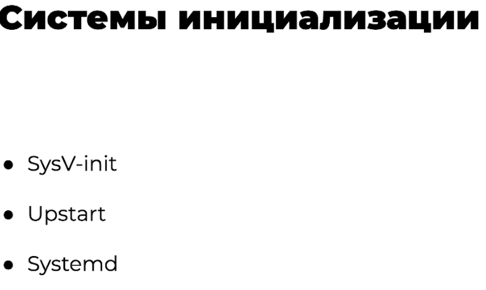

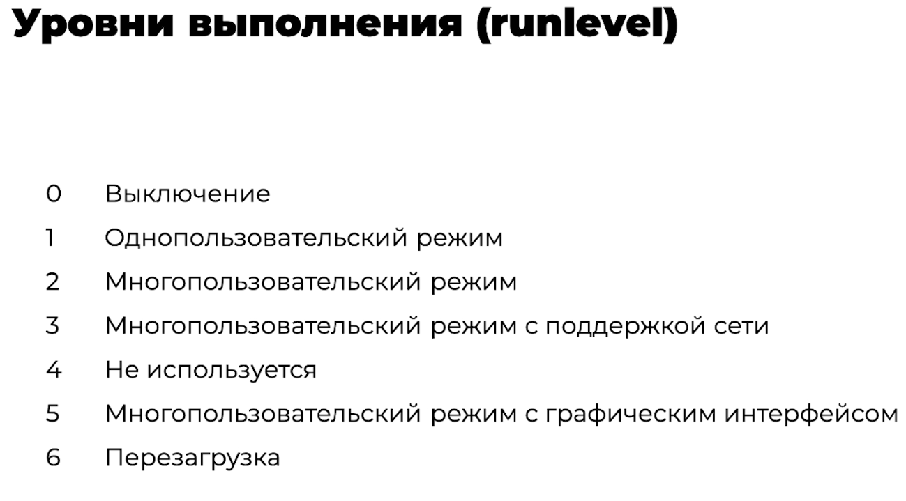

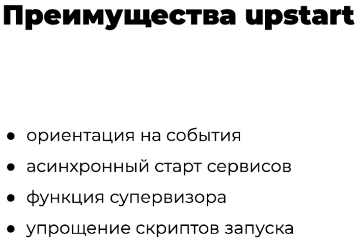

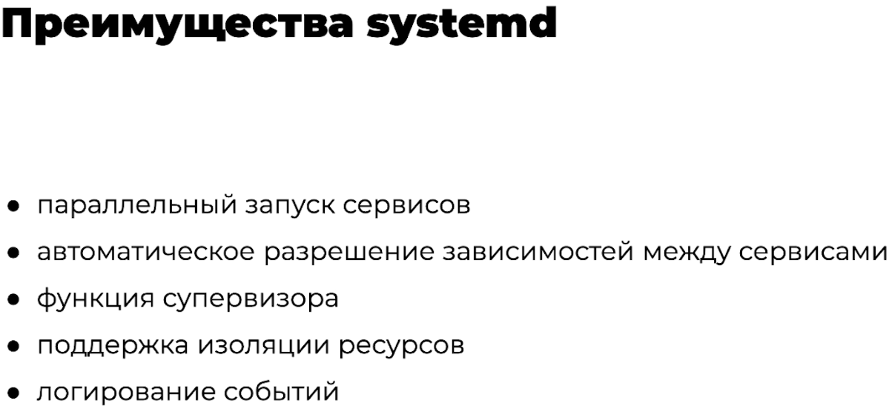

## Systemd

[Systemd за пять минут](https://habr.com/ru/companies/slurm/articles/255845/) (Хабр)

### Базовые команды

| Задача | Команда |
|---|---|
| Запустить и остановить сервис | `systemctl start <юнит>`, `systemctl stop <юнит>` |
| Состояние сервиса | `systemctl status <юнит>` |
| Включить и выключить автозапуск | `systemctl enable <юнит>`, `systemctl disable <юнит>` |
| Перечитать юниты после правок | `systemctl daemon-reload` |
| Журнал сервиса | `journalctl -u <юнит>` |

Пример готового юнита: [Proxmox → Wake-on-LAN](../virtualization/proxmox.md#wake-on-lan-для-ноды).

## Основные виды юнитов

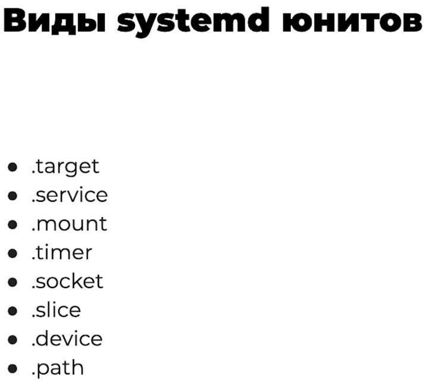

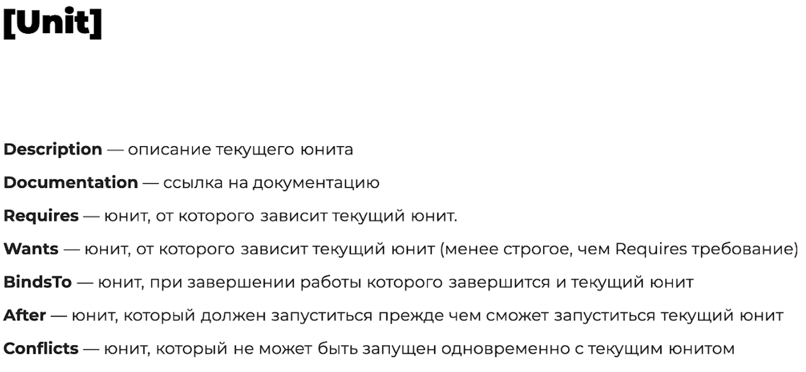

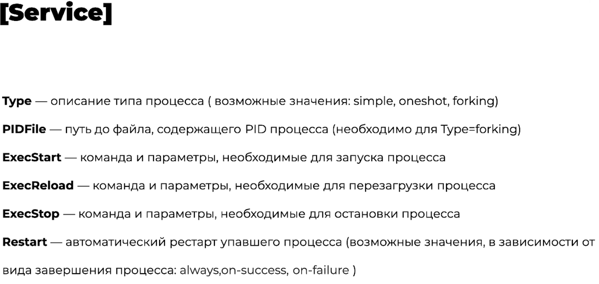

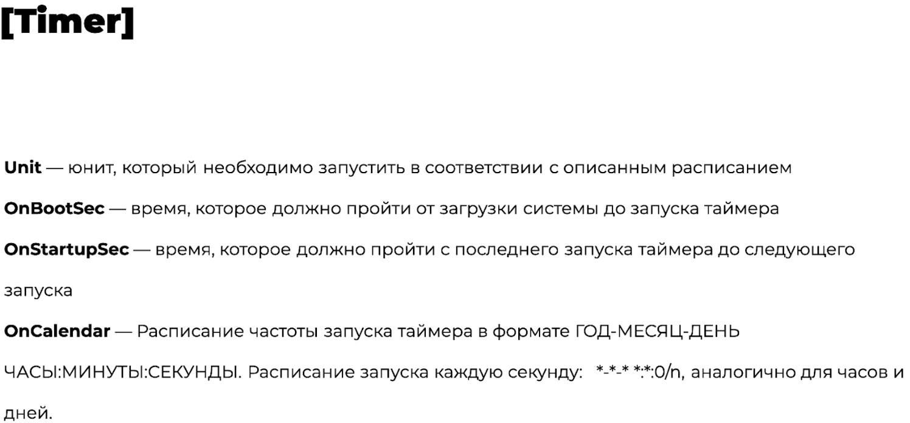

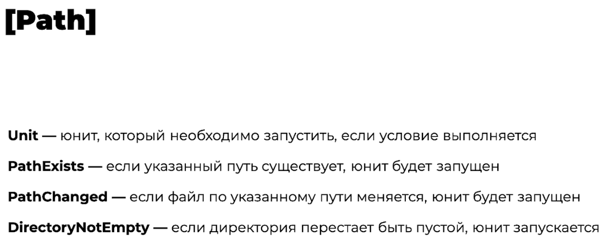

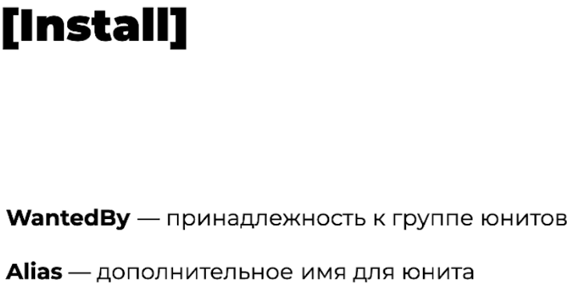

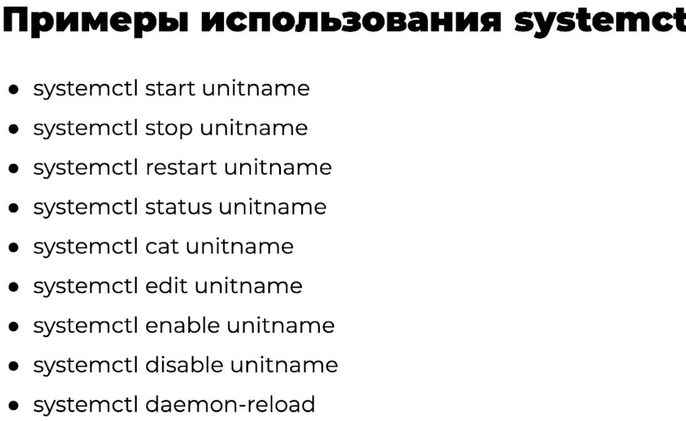

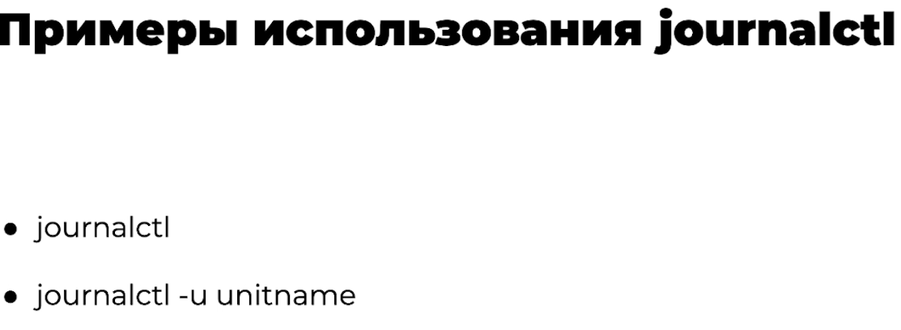
