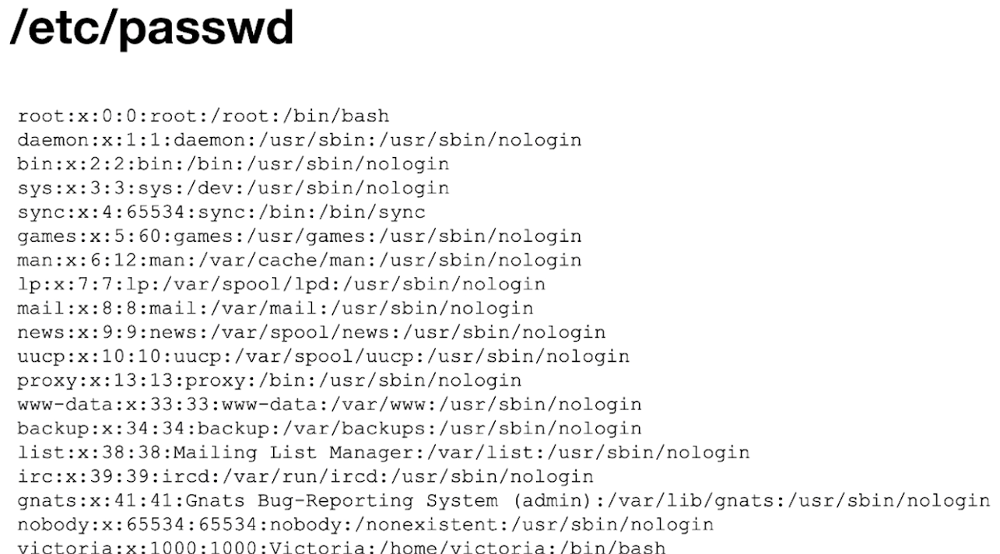
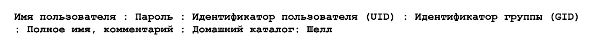
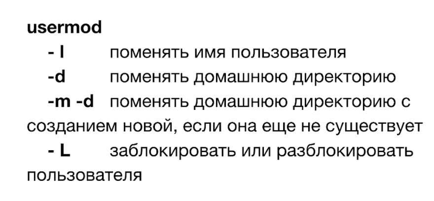
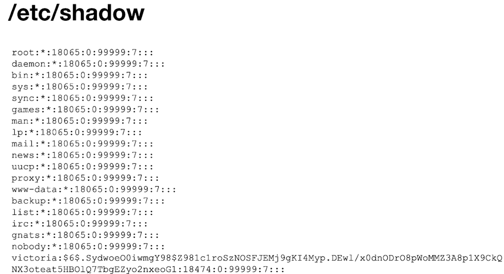
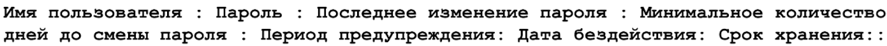
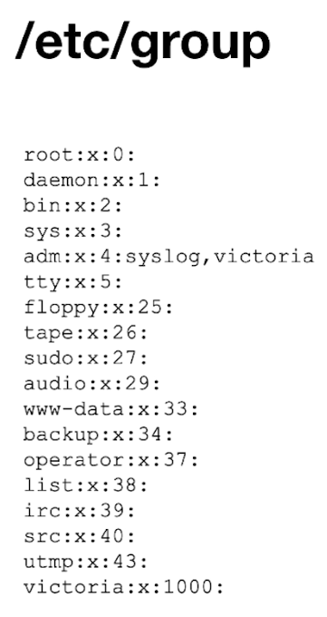
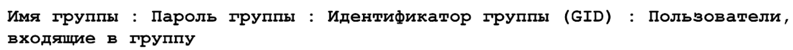
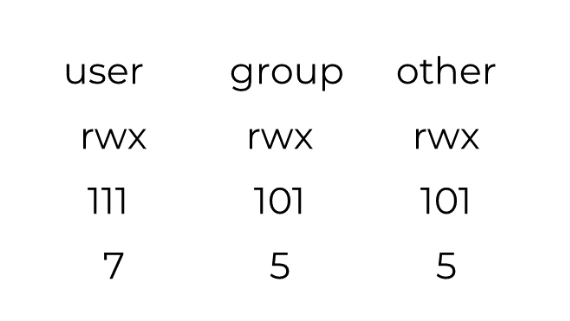

# Пользователи, группы и права

Как Linux хранит пользователей и группы, как их создавать и менять, как управлять доступом к файлам.

## Пользователи

Список пользователей лежит в файле `/etc/passwd`:



Запись о пользователе состоит из таких частей:



!!! info "Суперпользователь"
    Пользователь с `uid:gid` равным `0:0` (root) имеет неограниченные права на систему: удаление, изменение, добавление.

### Создание пользователя

=== "useradd"

    ```bash
    useradd -m -c "Username Usernameov" -g usergroup username
    ```

    Команда не интерактивная. Без ключей она не создаст домашний каталог (для этого нужен `-m`), не задаст пароль и не добавит пользователя в группу.

=== "adduser"

    ```bash
    adduser username
    ```

    Интерактивная команда: сама спросит пароль и данные пользователя и создаст домашний каталог.

!!! tip "Пароль"
    После `useradd` пароль задают отдельно: `passwd username`. Ключ `-p` ожидает уже хэшированный пароль, а не открытый текст.

### Изменение пользователя

Атрибуты меняет `usermod`. Команда тоже не интерактивная, поэтому нужные изменения передают ключами:



## Пароли

Хэши паролей хранятся в `/etc/shadow`. Читать файл может только root.

Структура файла:



Структура записи:



Сменить пароль:

```bash
passwd username
```

## Группы

Список групп лежит в `/etc/group`:



Формат записи группы:



Создать группу:

```bash
groupadd groupname
```



## Права доступа

Права задают цифрами: каждому праву соответствует число, а у класса пользователей они складываются.

| Право | Число |
|---|---|
| Чтение (`r`) | 4 |
| Запись (`w`) | 2 |
| Исполнение (`x`) | 1 |

```bash
sudo chmod 755 example.txt
```

Первая цифра относится к владельцу, вторая к группе, третья к остальным пользователям. Здесь владелец получает `7` (4+2+1, всё), группа и остальные `5` (4+1, чтение и исполнение).

!!! warning "Внимание"
    Права `777` дают полный доступ всем пользователям системы. Используйте их только для проверки и никогда на боевых данных.

## Специальные флаги доступа

=== "SUID"

    Файл запускается с правами **владельца файла**, а не того, кто его запускает.

    ```bash
    chmod u+s file
    ```

=== "SGID"

    - Файл запускается с правами **группы-владельца**, а не группы запускающего.
    - Для каталога: новые файлы внутри наследуют группу каталога, а не группу создавшего их пользователя.

    ```bash
    chmod g+s dir    # чаще всего применяется к каталогам
    ```

=== "Sticky bit"

    Удалить или переименовать файл в каталоге может только его владелец (а также владелец каталога и root). Пример: `/tmp`.

    ```bash
    chmod +t dir
    ```

!!! info "Подробнее"
    [Права доступа к файлам в Linux](https://losst.pro/prava-dostupa-k-fajlam-v-linux) (Losst).
