# Стек TCP/IP

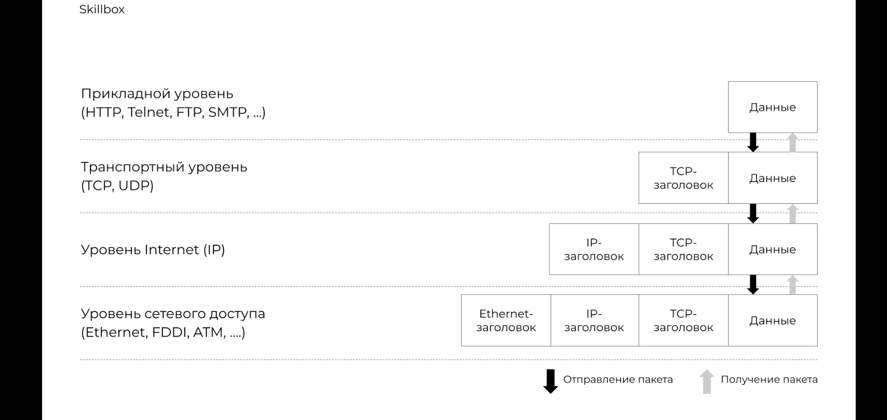

## Канальный уровень

Типы передачи данных:

- Unicast
- Multicast
- Broadcast

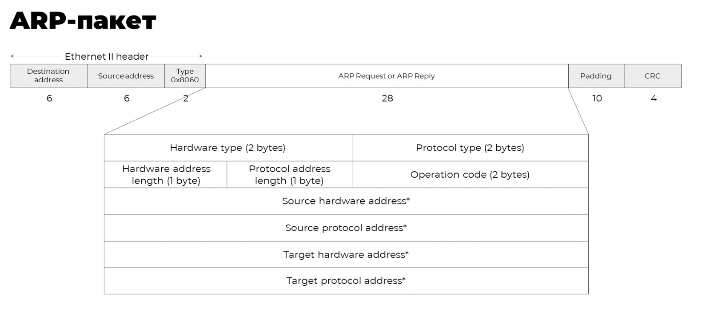

## Сетевой уровень

Схема IP-пакета:

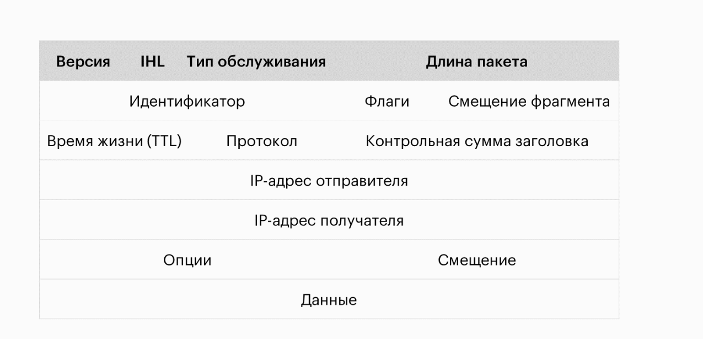

Маска подсети:

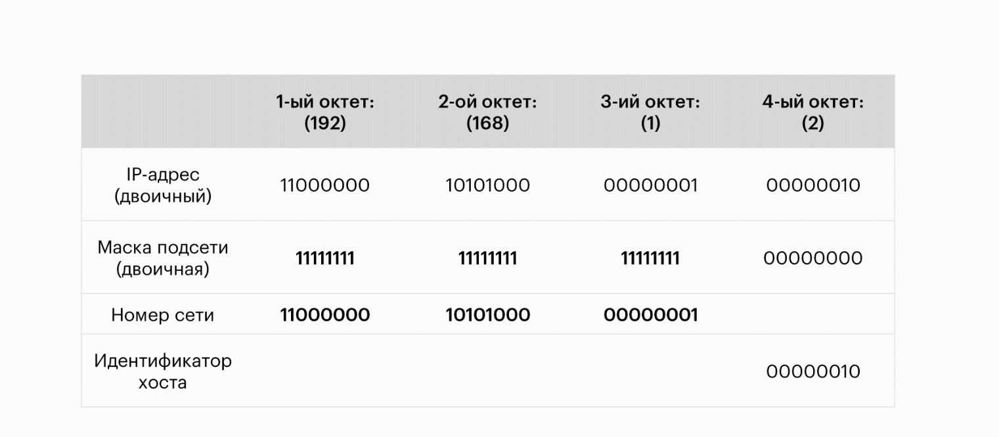

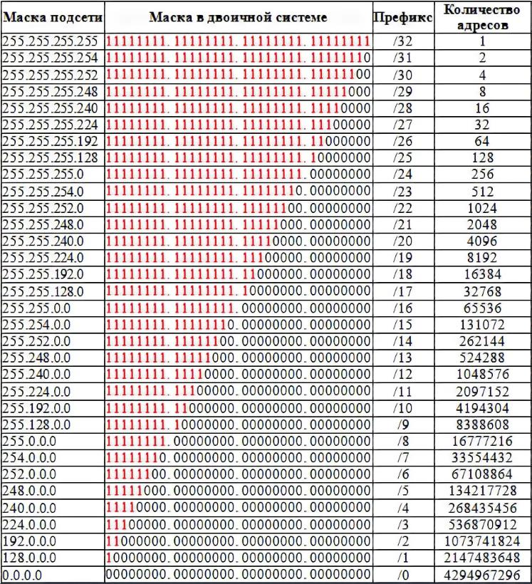

### Частные диапазоны

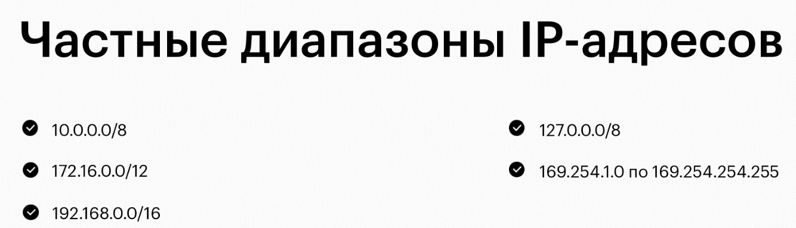

## Транспортный уровень

### Категории портов

| Категория | Диапазон |
|---|---|
| Хорошо известные порты | 0–1023 |
| Зарегистрированные порты | 1024–49151 |
| Динамические (частные) порты | 49152–65535 |

### Протокол UDP

Формат протокола:

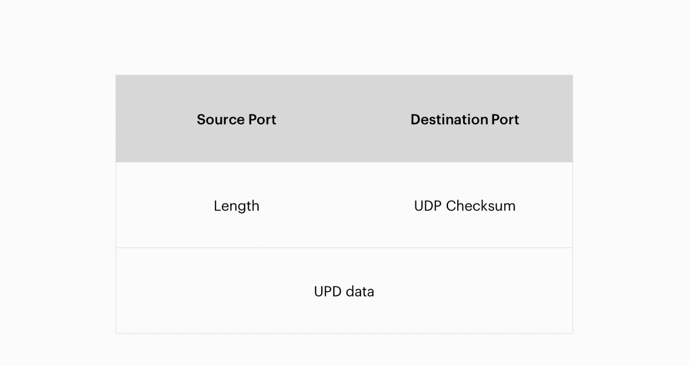

Сокет:

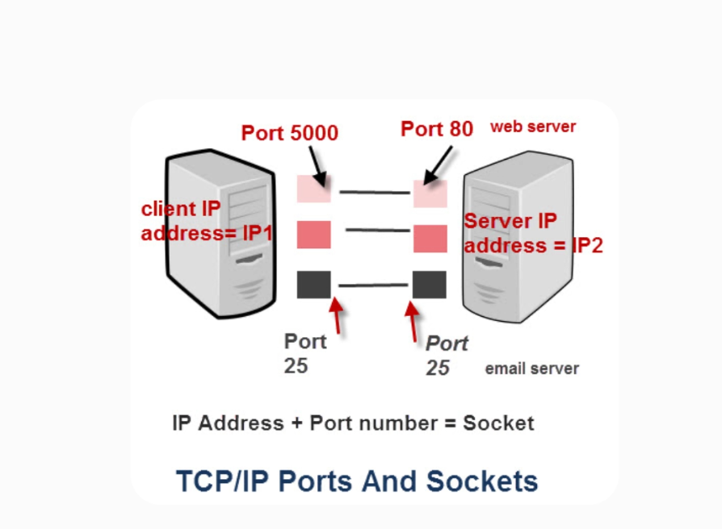

### Протокол TCP

Характеристики:

- установка соединения
- надёжность доставки
- доставка и сборка сегментов в определённом порядке
- контроль потока

Состав пакета TCP:

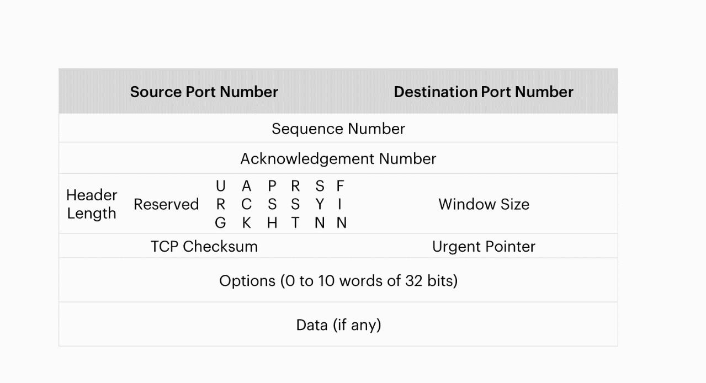

Флаги TCP:

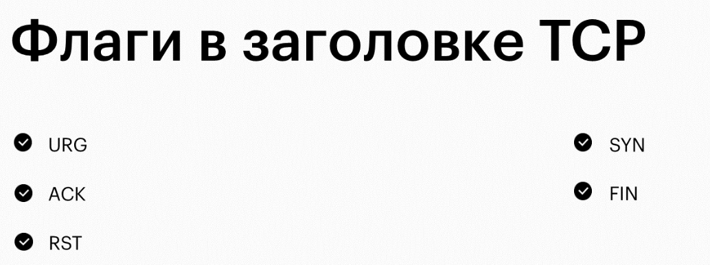

Установка соединения:

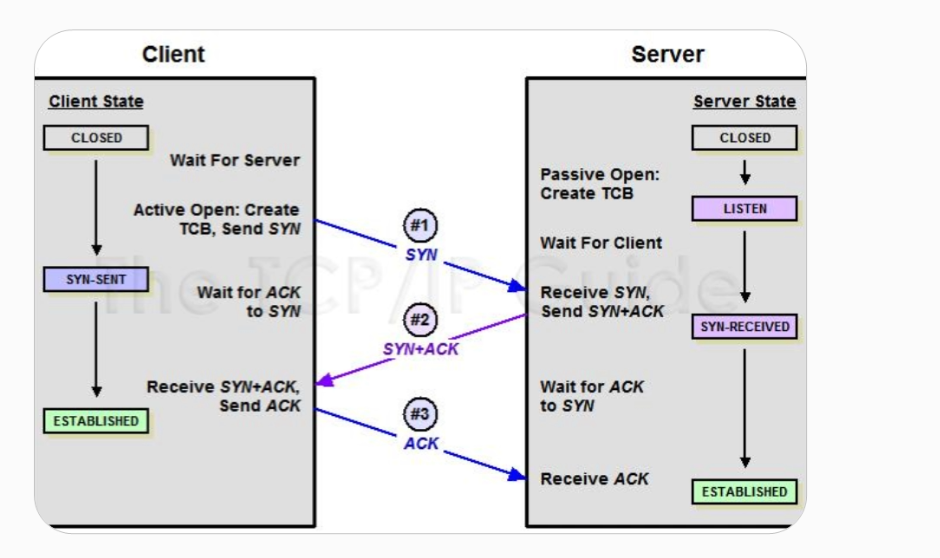

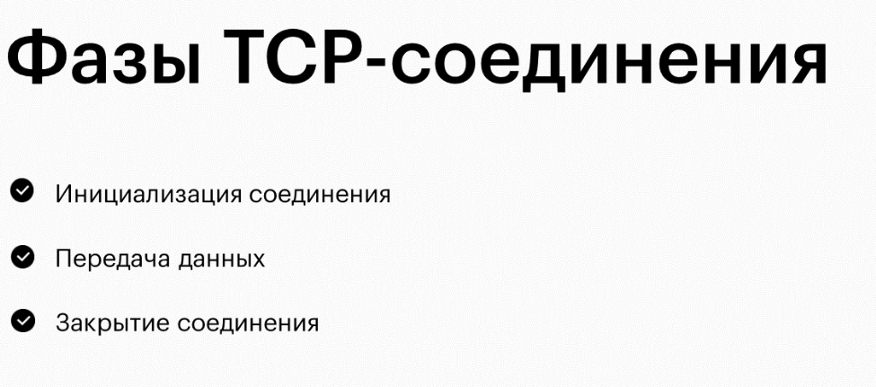

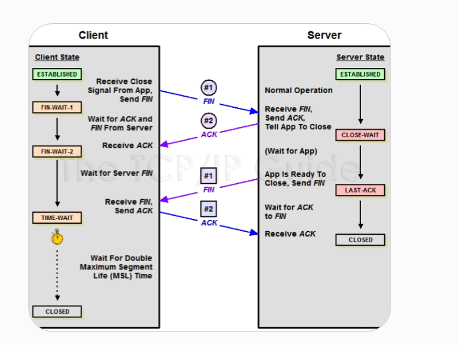

[Транспортный протокол TCP](https://sysadminium.ru/tcp/) (Sysadminium)

## Протоколы

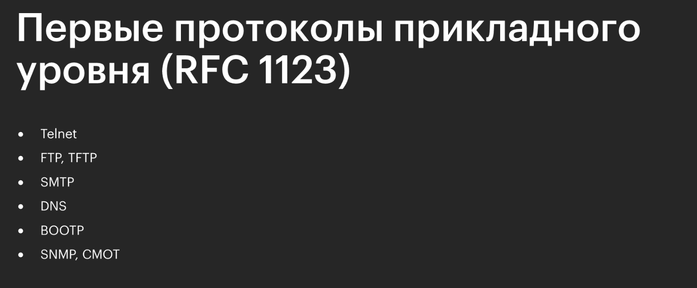

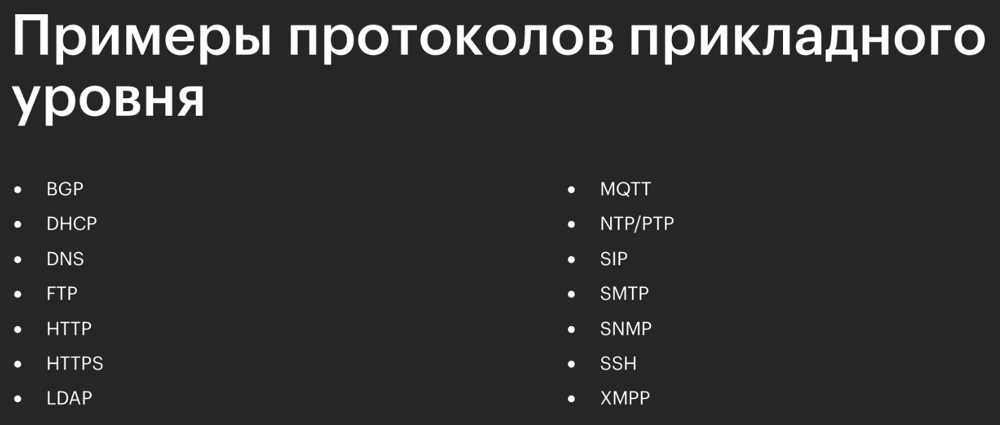
