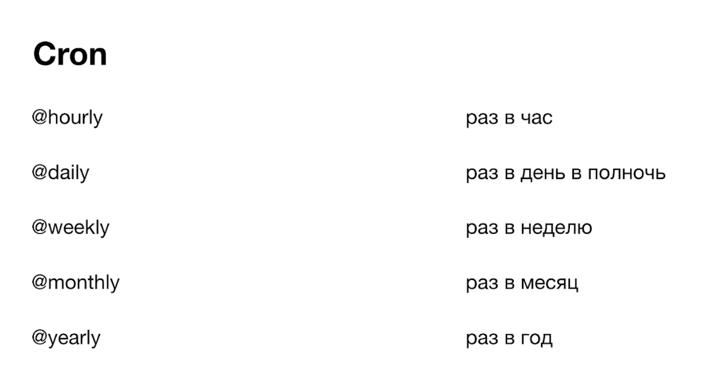
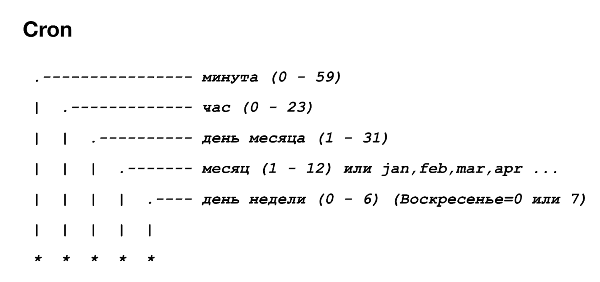
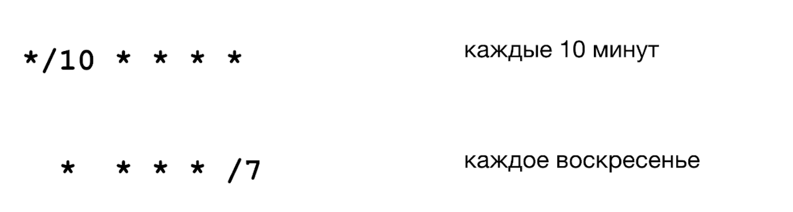
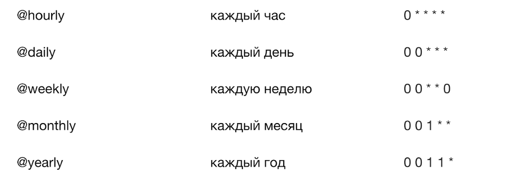
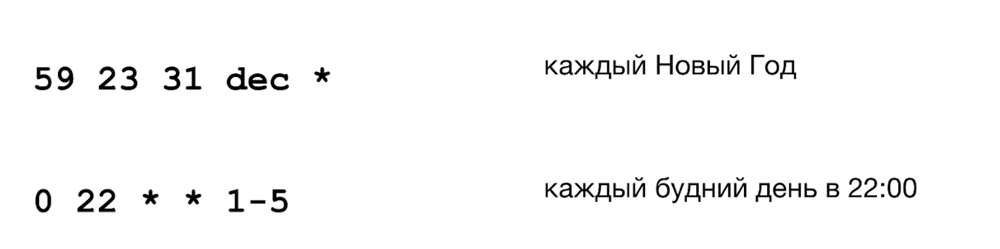
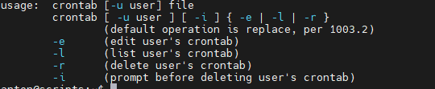

**Cron** запускает команды и скрипты по расписанию.

## Формат записи

Расписание хранится в crontab. Каждая строка состоит из пяти полей времени и команды:

```text
┌───────── минута (0–59)
│ ┌─────── час (0–23)
│ │ ┌───── день месяца (1–31)
│ │ │ ┌─── месяц (1–12)
│ │ │ │ ┌─ день недели (0–7, 0 и 7 — воскресенье)
│ │ │ │ │
* * * * *  команда
```

```bash
crontab -e   # редактировать свой crontab
crontab -l   # показать текущий
```

## Материалы курса














