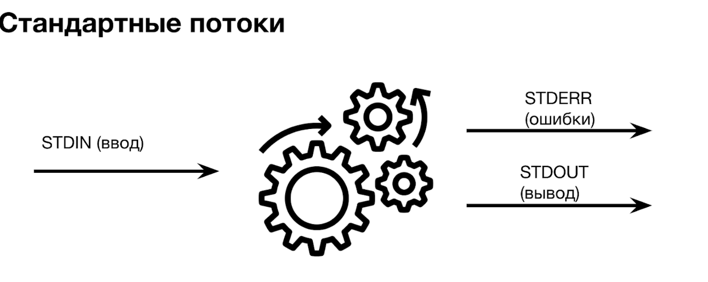
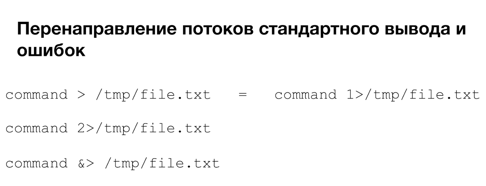

## Управление процессами

```bash
kill <PID>
```

Родительский процесс и другие приёмы: [Межпроцессное взаимодействие](../ipc/).

## Обработка вывода

Утилиты, которые преобразуют вывод одной команды для другой.

### cut

Выбирает отдельные поля из строк файла: колонки таблицы или части строки. В терминах баз данных это операция проекции.

```bash
cut опции путь_к_файлу
```

[Команда cut в Linux](https://losst.pro/komanda-cut-linux) (Losst)

### tr

Переводит или удаляет символы: меняет регистр, сжимает повторы, удаляет заданные символы, делает простую замену.

```bash
tr [КЛЮЧ]... НАБОР1 [НАБОР2]
```

[Команда tr в Linux](https://losst.pro/komanda-tr-v-linux) (Losst)

### xargs

Превращает строку со стандартного ввода в аргументы и передаёт их команде.

```bash
первая_команда | xargs опции вторая_команда аргументы
```

[Команда xargs в Linux](https://losst.pro/komanda-xargs-linux) (Losst)

### cat

Выводит файлы подряд, объединяя их в один поток. Если вместо имени файла указан `-`, читает стандартный ввод.

Когда нужен `cat`:

1. вывести файл без изменений;
2. объединить несколько файлов (например, части файла, разбитого командой `split`) или файлы со стандартным вводом;
3. просмотреть содержимое файла.

```bash
cat опции файл1 файл2 ...
```

[Команда cat в Linux](https://losst.pro/komanda-cat-linux) (Losst)

### du

Disk Usage: показывает, сколько места занимают файлы и каталоги.

```bash
du опции /путь/к/папке
du -h /путь/к/папке     # размеры в КБ, МБ, ГБ
```

[Команда du в Linux](https://losst.pro/komanda-du-v-linux) (Losst)

## Стандартные потоки

| Номер | Поток | Назначение |
|---|---|---|
| 0 | STDIN | ввод |
| 1 | STDOUT | вывод |
| 2 | STDERR | ошибки |

- Операторы перенаправления вывода: `>` (перезаписать файл), `>>` (дописать в конец).
- Пайп `|` передаёт стандартный вывод одной команды на стандартный ввод другой.



## Фоновые процессы и полезные команды

### Переменные

```bash
declare VAR=value    # создать переменную
declare -r PI=3.14   # создать константу
unset VAR            # удалить переменную
```

### Алиасы

`alias` без аргументов показывает все алиасы в системе. Алиас упрощает работу с длинной командой, например `ps -auxf` можно сократить до `pss`:

```bash
alias pss="ps -auxf"
```

### Фон и передний план

| Что сделать | Как |
|---|---|
| Запустить команду в фоне | добавить `&` в конец команды |
| Показать фоновые задачи | `jobs` |
| Перевести задачу в фон | `bg <номер задания>` |
| Вернуть задачу на передний план | `fg` |

[Как запустить процесс в фоне в Linux](https://losst.pro/kak-zapustit-protsess-v-fone-linux) (Losst)

Вывод команды можно отправить «в пустоту»:

```bash
traceroute ya.ru &> /dev/null
```

## Коды возврата

Код возврата последней команды лежит в переменной `$?`:

```bash
echo $?
```



| Код | Значение |
|---|---|
| `0` | успешное выполнение |
| `1` | ошибка |
| `2` | ошибка использования встроенных команд шелла |
| `126` | команду, которую вызвали, нельзя исполнить |
| `127` | команда не найдена |
