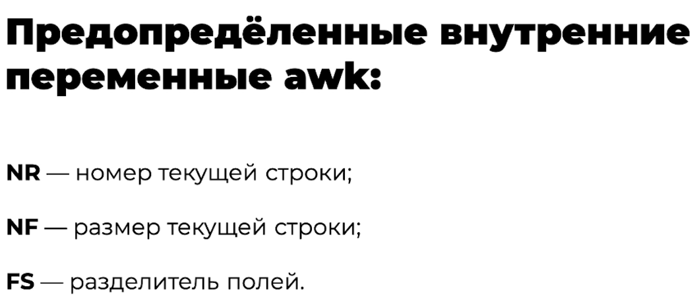
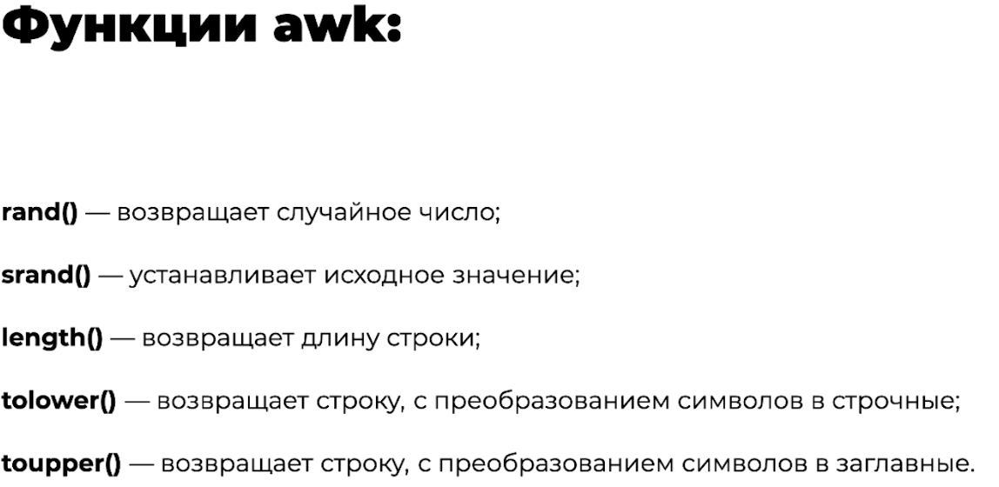
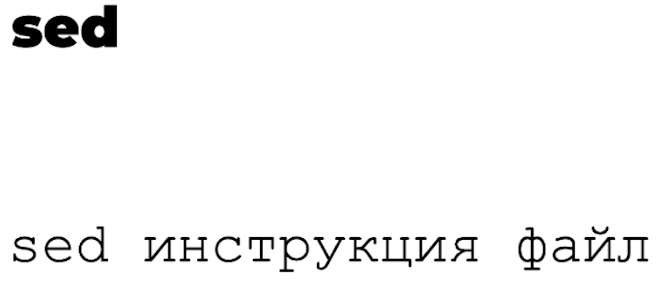
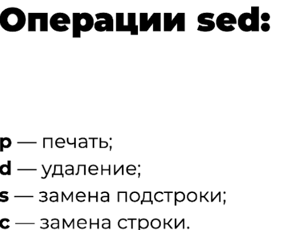
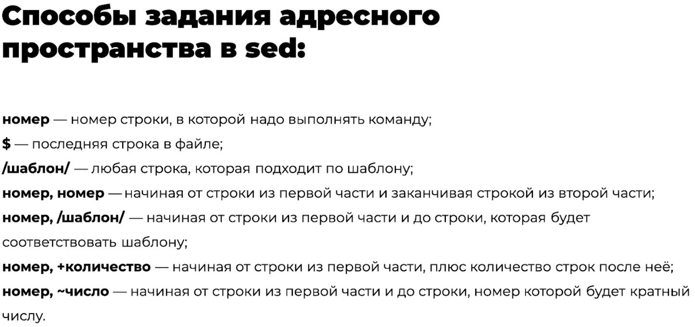

## Архивация: tar

`tar` встроен в Unix и Linux: он упаковывает и распаковывает архивы и умеет многое другое. Сам по себе `tar` не сжимает, но отлично работает с Gzip и BZip2, которые и выполняют сжатие.

| Задача | Команда |
|---|---|
| Создать сжатый архив | `tar -czf archive.tar.gz dir/` |
| Распаковать | `tar -xzf archive.tar.gz` |
| Посмотреть содержимое | `tar -tzf archive.tar.gz` |

[Команда tar: архивация, распаковка и сжатие файлов в Linux](https://timeweb.com/ru/community/articles/komanda-tar-arhivaciya-raspakovka-i-szhatie-faylov-v-linux) (Timeweb)

## AWK

Один из самых мощных инструментов для обработки и фильтрации текста. Это не просто утилита, а язык для обработки и извлечения данных.

[Использование awk в Linux](https://losst.pro/ispolzovanie-awk-v-linux) (Losst)

## SED

Потоковый редактор текста: ищет, вставляет, заменяет и удаляет фрагменты в файле. Редактировать файлы можно, не открывая их: проще написать, что на что заменить, чем открывать редактор, искать строку и менять вручную.

[Команда sed в Linux](https://losst.pro/komanda-sed-linux) (Losst)

