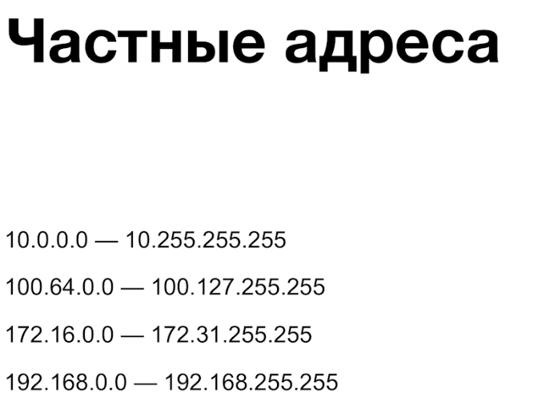
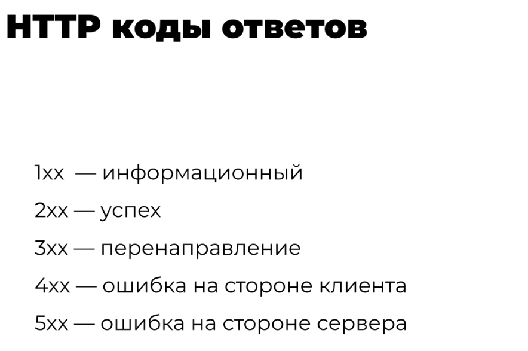
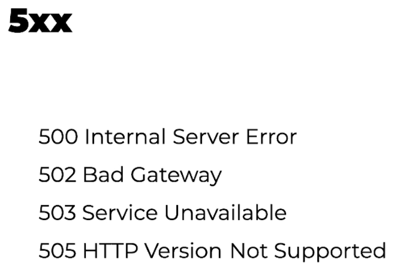

## IP и DNS

**traceroute** показывает, какой путь проходит пакет до конечного хоста.

**mtr** расширяет `traceroute`: заодно пингует каждый узел на пути и показывает задержку до него.

## HTTP

[Простым языком об HTTP](https://habr.com/ru/articles/215117/) (Хабр)

