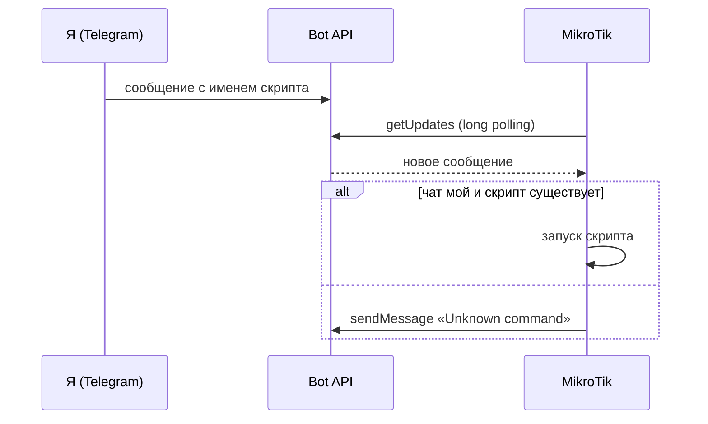

:::note[Коротко]
MikroTik опрашивает Telegram-бота и запускает у себя скрипт, имя которого совпадает с текстом сообщения. Так можно включить домашний компьютер или сервер одним сообщением, без VPN.
:::

## Проблема

Появилась потребность запускать домашний компьютер или сервер удалённо.
VPN для этой задачи избыточен, поэтому решено запускать скрипты командами Telegram-бота.

## Как это работает



Роутер сам ходит в Telegram, поэтому порты на нём открывать не нужно.

## Подготовка

1. Создайте бота у `@BotFather` и сохраните токен.
2. Узнайте свой `chat id`: напишите боту любое сообщение и откройте в браузере

    ```text
    https://api.telegram.org/bot<TOKEN>/getUpdates
    ```

    В ответе нужное значение лежит в поле `chat` → `id`.

:::caution[Токен бота]
Токен даёт полный контроль над ботом. Не публикуйте его в репозитории и в заметках: в примерах ниже стоят плейсхолдеры.
:::

## Скрипт-опрос

Создайте на MikroTik скрипт с именем `ParseTelegramMessages` и подставьте токен в `botID` и свой `chat id` в `myChatID`:

```text
:global botID ""        #Сюда вставить токен бота
:global myChatID ""     #Сюда вставить chat id
:global messageId 0

:while (true) do={
    :log info "Fetching updates from Telegram"
    :tool fetch url="https://api.telegram.org/bot$botID/getUpdates?offset=$messageId&timeout=60" dst-path=getUpdates.txt mode=https
    :delay 1

    :local content [/file get getUpdates.txt contents]
    :if ([:len $content] > 30) do={
        :log info "Received update: $content"
        :local startLoc ([:find $content "update_id" -1] + 11)
        :local endLoc [:find $content "," $startLoc]
        :set messageId ([:pick $content $startLoc $endLoc] + 1)

        :local startLoc ([:find $content "text" -1] + 7)
        :local endLoc [:find $content "," $startLoc]
        :local message [:pick $content ($startLoc + 1) ($endLoc - 1)]

        :local startLoc ([:find $content "chat" -1] + 12)
        :local endLoc [:find $content "," $startLoc]
        :local chatId [:pick $content $startLoc $endLoc]

        :log info "Message: $message from chat: $chatId"
        :if (($chatId = $myChatID) and ([system script find name=$message] != "")) do={
            :log info "Executing script: $message"
            :system script run $message
        } else={
            :tool fetch url="https://api.telegram.org/bot$botID/sendMessage?chat_id=$chatId&text=Unknown command: $message" mode=https keep-result=no
        }
    } else={
        :log error "No valid updates received"
    }
}
```

Запускать этот скрипт нужно по расписанию. Создайте задание в **System → Scheduler** (параметр `start-time=startup` запустит его при загрузке роутера) со строкой:

```text
:system script run ParseTelegramMessages
```

## Скрипт для WOL

Создайте второй скрипт. **Его имя и есть команда для бота**: например, скрипт `wol-pc` запускается сообщением `wol-pc`.

```text
/tool wol mac=XX:XX:XX:XX:XX:XX interface=lan-bridge

/tool fetch url="https://api.telegram.org/bot<TOKEN>/sendmessage?chat_id=<CHAT_ID>&text=WOL PC ok" keep-result=no
```

Подставьте MAC-адрес включаемого устройства, свой интерфейс (здесь `lan-bridge`), токен и `chat id`. Вторая строка присылает в Telegram подтверждение.

:::tip[Включение ноды Proxmox]
Чтобы будить сервер, на нём должен быть включён Wake-on-LAN: см. [Proxmox → WOL](../../virtualization/proxmox/#wake-on-lan-для-ноды).
:::
